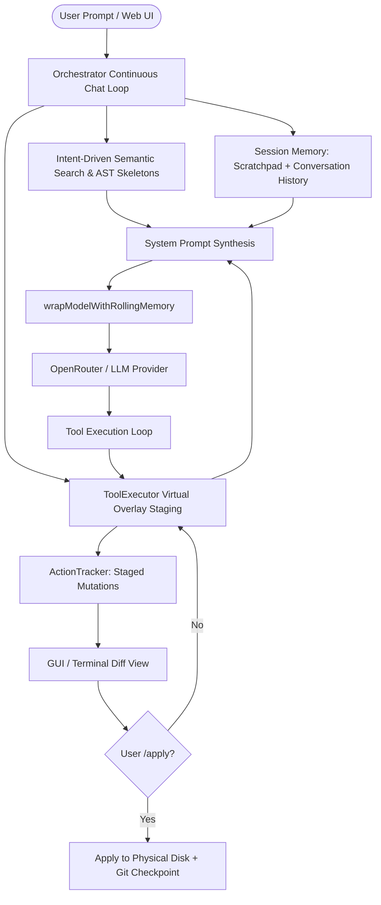

# 🏛️ OpenClaw Architecture & System Design

> **Overview**: OpenClaw is a desktop autonomous coding agent featuring risk-tiered human-in-the-loop approval, in-memory mutation staging, intent-driven GraphRAG retrieval, and rolling-state memory.

---

## 1. System Components & Data Flow

---

## 2. In-Memory Virtual Overlay (Staging Area)

### Problem it Solves
Code modifications must never blindly overwrite a user's working tree before explicit user review and confirmation (`/apply`).

### How It Works ([modes/agents/tool-executor.ts](file:///c:/Users/abhinav/OneDrive/Desktop/openclaw/modes/agents/tool-executor.ts))
- **`overlay: Map<string, string>`**: Stores staged text files in memory.
- **`deleted: Set<string>`**: Tracks files staged for deletion without touching the real disk.
- **Overlay-Aware Tools**:
  - `readFile(rel)`: Reads from `overlay` first via `getEffectiveText()`. If not in memory, reads from disk.
  - `listFiles(rel, recursive)`: Merges physical directory entries with in-memory overlay entries and filters out deleted files.
  - `searchFiles(root, glob, query)`: Searches both disk and in-memory staged files.
  - `tempWriteStaged()`: Temporarily writes staged files to disk solely during self-healing project checks (`runProjectChecks`), then cleans them up so the working tree remains pristine until `/apply`.

---

## 3. Context Management & Rolling Memory Architecture

### Component Breakdown

| Layer | Component | Implementation File | Purpose |
| :--- | :--- | :--- | :--- |
| **Session Scratchpad** | Persistent State | [modes/agents/orchestrator.ts](file:///c:/Users/abhinav/OneDrive/Desktop/openclaw/modes/agents/orchestrator.ts) | Holds a concise running summary of actions, findings, and unapplied changes across all turns in a session. |
| **Conversation History** | Turn Buffer | [modes/agents/orchestrator.ts](file:///c:/Users/abhinav/OneDrive/Desktop/openclaw/modes/agents/orchestrator.ts) | Maintains the last 10 conversational user/assistant messages so the model understands followup instructions ("re modify what you did last"). |
| **Model Wrapper** | Rolling Compactor | [ai/memory.ts](file:///c:/Users/abhinav/OneDrive/Desktop/openclaw/ai/memory.ts) | Auto-summarizes intermediate tool logs when message history exceeds 8 turns while preserving conversational turns and system rules. |
| **GraphRAG Semantic Retrieval** | Code Context | [utils/semantic-retrieval.ts](file:///c:/Users/abhinav/OneDrive/Desktop/openclaw/utils/semantic-retrieval.ts) | Embeds and queries code symbols and files using local SQLite (`agent-index.db`) with TF-IDF fallback. |
| **AST Repo Map** | Global Outline | [utils/repo-map.ts](file:///c:/Users/abhinav/OneDrive/Desktop/openclaw/utils/repo-map.ts) | Extracts classes, functions, and line ranges into an overarching structural map. |
| **Import Crawling** | 2-Hop Skeletons | [modes/agents/orchestrator.ts:37-107](file:///c:/Users/abhinav/OneDrive/Desktop/openclaw/modes/agents/orchestrator.ts#L37-L107) | Resolves imported modules recursively and extracts their signatures without bloating tokens. |
| **Staged Summary** | Overlay Visibility | [modes/agents/tool-executor.ts](file:///c:/Users/abhinav/OneDrive/Desktop/openclaw/modes/agents/tool-executor.ts) | Injects a bulleted list of all uncommitted files into the system prompt on every turn so the agent is never blind to its own staged work. |
| **Browser Control Engine** | Live Web Agency | [services/browser-service.ts](file:///c:/Users/abhinav/OneDrive/Desktop/openclaw/services/browser-service.ts) | Launches installed system browser (Chrome/Edge) with persistent profile (`.openclaw/browser-data`) and anti-bot evasion flags. |

---

## 4. Omni-Action Desktop Architecture: Pillar 1 (Browser Integration)

- **System Browser Channel First**: Automatically launches the user's installed Google Chrome (`channel: "chrome"`) or Microsoft Edge (`channel: "msedge"`) directly without requiring manual `--remote-debugging-port` startup flags or downloading ~400MB Playwright Chromium binaries.
- **Persistent User Session Profile**: Profiles persist in `./.openclaw/browser-data`, maintaining login cookies, localStorage, and session state across agent runs.
- **Anti-Bot & Automation Evasion**: Disables `navigator.webdriver` via `--disable-blink-features=AutomationControlled` and strips `--enable-automation` banners to avoid aggressive bot/Cloudflare roadblocks.
- **Navigation Race-Condition Resilience**: `getSnapshot()` wraps DOM tree evaluation with automatic retry logic if page navigations destroy the execution context mid-evaluation.
- **Optional CDP Mode**: Preserves backward compatibility to attach to an external CDP port (`localhost:9223`) if explicitly flagged.
- **Semantic ARIA Snapshot**: Filters raw HTML down to actionable DOM nodes with numeric identifiers (`[ref=1]`, `[ref=2]`), preventing LLM context token bloat.
- **Risk-Tiered Execution**: Classified via [modes/agents/risk-classifier.ts](file:///c:/Users/abhinav/OneDrive/Desktop/openclaw/modes/agents/risk-classifier.ts), ensuring financial/sensitive actions require human approval.

---

## 5. Semantic Retrieval & Fallback Engine (`utils/semantic-retrieval.ts`)

- **Dual-Mode Vector/Keyword Indexing**:
  - Attempts remote embedding vectorization via OpenRouter (`openai/text-embedding-3-small`).
  - **Graceful Local Fallback**: When network requests abort or the Embeddings API times out, seamlessly defaults to an in-memory TF-IDF + BM25 keyword overlap engine without halting session execution.
  - **Silent High-Throughput Calculation**: Term frequencies and dot products are calculated silently across candidate symbols and AST skeletons.

