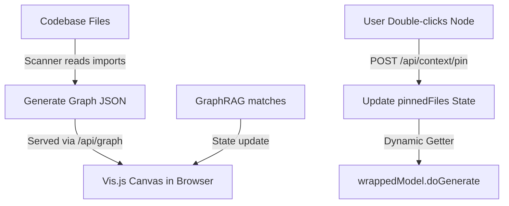
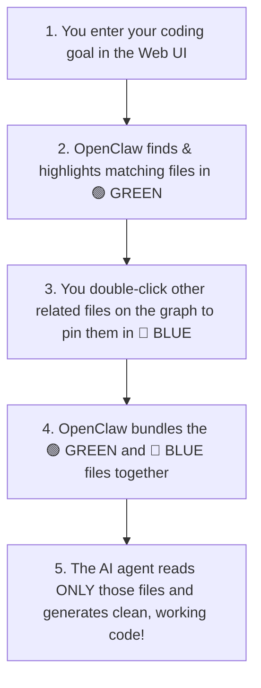
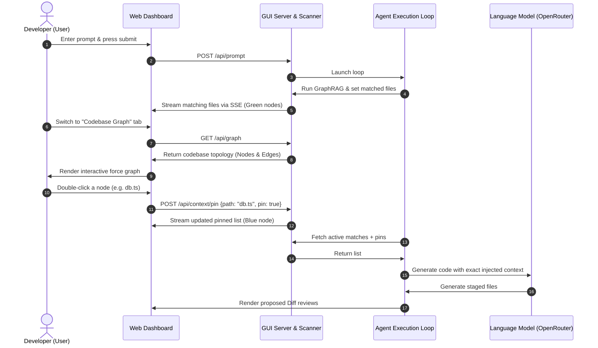

# Documentation: Visual Codebase Dependency Graph (Smart Context Control)

This document explains the architecture, design choices, and execution flow of the interactive codebase dependency graph in OpenClaw.

---

## 1. Overview
The **Visual Codebase Dependency Graph** is an interactive, force-directed graph rendered directly inside the OpenClaw Web UI dashboard. It visualizes the internal file structure and import dependencies, allowing users to dynamically control what files are included in the agent's context.

---

## 2. Before vs. After Implementation

| Metric / Behavior | Before (Static Retrieval) | After (Interactive Context Control) |
| :--- | :--- | :--- |
| **Context Source** | Only files matched by static GraphRAG semantic searches. | Merged set of GraphRAG semantic matches + manual user-pinned files. |
| **Context Lifetime** | **Static**: Evaluated once at agent boot; locked for the entire run. | **Dynamic**: Evaluated on every generation turn; updates in real-time. |
| **User Visibility** | Blind terminal logs listing matched files. | Interactive, force-directed visual map of file connections. |
| **Developer Controls** | None (must type raw prompts to force file inclusion). | Double-click nodes directly on the graph to pin/unpin context. |

---

## 3. How It Works Under the Hood

The feature is split into three main parts: **Scanning (Backend)**, **Serving/API (Server)**, and **Interactive Rendering (Frontend)**.



### Phase A: Dependency Scan (Backend)
Located in [graph-scanner.ts](file:///c:/Users/abhinav/OneDrive/Desktop/openclaw/utils/graph-scanner.ts):
1.  Recursively crawls source files (`.ts`, `.js`, `.tsx`, `.jsx`, `.json`).
2.  Extracts import specifiers using Regex patterns matching `import ... from`, `require()`, and dynamic `import()`.
3.  Resolves target paths relative to the importing file (handling directory resolutions and extension fallbacks).
4.  Constructs a graph payload of **Nodes** (files with file size and directory groups) and **Edges** (directed lines matching import references).

### Phase B: GUI Server Endpoints & State (Server)
Located in [gui-server.ts](file:///c:/Users/abhinav/OneDrive/Desktop/openclaw/modes/agents/gui-server.ts):
1.  **State Management**: Holds `pinnedFiles` (user locked selections) and `graphMatchedFiles` (GraphRAG matches).
2.  **`GET /api/graph`**: Calls the scanner and serves the topology JSON.
3.  **`POST /api/context/pin`**: Toggles a file path in the `pinnedFiles` array.
4.  **Getters**: Exposes `getPinnedFiles()` for the orchestrator to fetch at execution runtime.

### Phase C: Vis.js Force-Directed Canvas (Frontend UI)
Located in the HTML script tag of [gui-server.ts](file:///c:/Users/abhinav/OneDrive/Desktop/openclaw/modes/agents/gui-server.ts#L365):
1.  Renders tab buttons allowing toggling between `Staged Diffs` and `Codebase Graph`.
2.  Loads `vis-network` (Vis.js standalone library) to display nodes as interactive dots. Node sizes are proportional to their file sizes.
3.  Syncs colors via Server-Sent Events (SSE):
    *   🟢 **Green (GraphRAG matched)**: Semantically matched files.
    *   🔵 **Blue (User pinned)**: Pinned files.
    *   ⚪ **Grey (Unloaded)**: Skeletal map files.
4.  Attaches double-click events to nodes to trigger `/api/context/pin` API requests, instantly toggling pinning state.

---

## 4. Dynamic Context Hook Integration
To allow context changes to apply mid-run, [memory.ts](file:///c:/Users/abhinav/OneDrive/Desktop/openclaw/ai/memory.ts) and [orchestrator.ts](file:///c:/Users/abhinav/OneDrive/Desktop/openclaw/modes/agents/orchestrator.ts) wrap the LLM with a **getter function**:

```typescript
const getSemanticFilesContent = () => {
    const pinned = guiServer ? guiServer.getPinnedFiles() : [];
    const allFiles = Array.from(new Set([...relatedFiles.map(f => f.path), ...pinned]));
    return allFiles.map(p => `--- File: ${p} ---\n${fs.readFileSync(p, "utf8")}`).join("\n\n");
};

// Passed to model wrapper as a dynamic evaluator
const wrappedModel = wrapModelWithRollingMemory(rawModel, goal, skeletalMap, getSemanticFilesContent);
```

On each generation step, the wrapped model evaluates the function to retrieve the most up-to-date file contents, ensuring user selections are instantly honored.

---

## 5. User-Facing Workflow (How It Works for the User)

### Step-by-Step Experience:
1.  **Launch Web Companion**: Run `Abhiclaw wakeup` in the terminal and select the `Web UI (Browser Chat Dashboard)` option. Open `http://127.0.0.1:8000` in your web browser.
2.  **Submit a Goal**: Enter a prompt describing the task (e.g. *"Refactor database helper to add log statements"*).
3.  **Inspect Codebase Map**: Click the **Codebase Graph** tab on the right panel.
    - You will see your codebase rendered as a network of nodes, with import connections drawn as lines.
    - GraphRAG automatic semantic matches are automatically highlighted in **🟢 green**.
4.  **Pin Missing Files**: Double-click on any related file node (e.g. `utils/logger.ts`) to pin it. The node changes color to **🔵 blue**.
5.  **Unpin Files**: Double-click any pinned node to unpin it (changing color back to unloaded grey).
6.  **Agent Turn Execution**: The agent automatically merges the full contents of all green and blue nodes in its prompt, executing the task with the customized context.

### Simple Workflow Diagram



### Detailed Sequence Diagram


