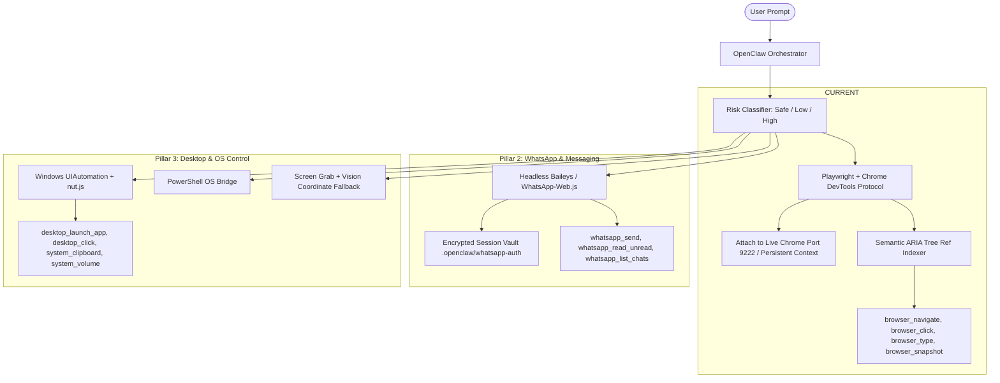

# 🌐 Pillar 1: Full Browser Control Architecture & Implementation Guide

> **Target Goal**: Enable OpenClaw to control your web browser as an autonomous agent—navigating pages, clicking buttons, filling inputs, extracting data, and reading live web applications without consuming thousands of unnecessary tokens.

---

## 🗺️ Master 3-Pillar Roadmap Overview

Before zooming into Pillar 1, here is the full progression path for evolving OpenClaw into an Omni-Action Desktop Agent:



| Pillar | Focus | Core Tech Stack | Primary Challenge Solved |
| :--- | :--- | :--- | :--- |
| **Pillar 1** | **Live Browser Control** | `playwright`, Chrome DevTools Protocol (CDP), ARIA Accessibility Tree | Preserves user logins, bypasses bot detection, prevents token explosion |
| **Pillar 2** | **WhatsApp & Communications** | `whatsapp-web.js` / `@whiskeysockets/baileys` | Background messaging, persistent QR session, human-in-the-loop safeguards |
| **Pillar 3** | **Desktop OS & Apps** | Windows UIAutomation, PowerShell, `@nut-tree/nut-js` | Interacting with native apps (Spotify, Notepad, File Explorer) and system controls |

---

# 📖 Pillar 1 Deep Dive: Browser Integration

## 1. Architectural Strategy: Why Playwright + CDP?

In modern desktop AI assistants, there are three common mistakes developers make when implementing browser access:
1. **Launching a fresh, incognito browser every time**: This forces you to log into Google, GitHub, or any website repeatedly and triggers CAPTCHAs.
2. **Dumping raw HTML into LLM context**: A standard web page contains between 50,000 and 150,000 tokens of CSS, SVG paths, scripts, and hidden divs. This causes context overflow, high API costs, and model hallucinations.
3. **Using screenshot-only clicking**: Pure vision is slow (5-10s per action) and brittle to resolution changes.

### The Modern Industry Solution
- **Connect over CDP (Chrome DevTools Protocol)**: Connect directly to your existing browser instance via port `9222`. The agent instantly inherits all your active cookies, logins, and session state.
- **Semantic ARIA Element Tree**: Instead of raw HTML, the agent receives an interactive accessibility tree where every actionable button, link, and input is given a clean handle: `[ref=1]`, `[ref=2]`. The LLM simply calls `browser_click({ ref: 2 })`.

---

## 2. Component-by-Component Implementation Guide

### Component A: The Browser Service (`services/browser-service.ts`)

#### Purpose & Rationale
This service is the central browser process manager. It provides a singleton connection that either attaches to your running Chrome instance over CDP (`localhost:9222`) or gracefully falls back to an isolated persistent browser context if Chrome is not open in debugging mode.

#### Inputs, Outputs & Side Effects
- **Inputs**: URLs, element selectors/refs, input text strings.
- **Outputs**: Page snapshots, status messages, element texts, screenshots (base64/buffer).
- **Side Effects**: Opens tabs, navigates web pages, modifies web form inputs, clicks web elements.

```typescript
/**
 * file: services/browser-service.ts
 * 
 * OpenClaw Browser Automation Service
 * Connects to Google Chrome via Chrome DevTools Protocol (CDP) or launches
 * a persistent browser instance. Provides high-level agent control over tabs,
 * DOM interactions, and semantic element accessibility extraction.
 */

import { chromium, type Browser, type BrowserContext, type Page } from "playwright";
import path from "node:path";
import fs from "node:fs";

export interface InteractiveElement {
  ref: number;
  role: string;
  name: string;
  selector: string;
  tag: string;
  value?: string;
}

export interface PageSnapshot {
  url: string;
  title: string;
  elements: InteractiveElement[];
  summaryText: string;
}

export class BrowserService {
  private static instance: BrowserService | null = null;
  private browser: Browser | null = null;
  private context: BrowserContext | null = null;
  private activePage: Page | null = null;
  private cdpPort: number = 9222;
  private lastElementMap: Map<number, string> = new Map();

  private constructor() {}

  /**
   * Singleton accessor ensures only one browser controller instance exists across the agent.
   */
  public static getInstance(): BrowserService {
    if (!BrowserService.instance) {
      BrowserService.instance = new BrowserService();
    }
    return BrowserService.instance;
  }

  /**
   * Initializes the browser connection.
   * Strategy:
   * 1. First, attempts to connect to an existing Chrome instance on port 9222 (remote debugging).
   * 2. If no debugger is running, launches a persistent Chromium context stored in .openclaw/browser-data
   *    so logins and cookies persist across runs without touching your main browser setup.
   */
  public async init(preferCdp = true): Promise<string> {
    if (this.context && this.activePage && !this.activePage.isClosed()) {
      return "Browser is already active and ready.";
    }

    if (preferCdp) {
      try {
        // Attempt connecting to user's active Chrome on debugging port
        this.browser = await chromium.connectOverCDP(`http://127.0.0.1:${this.cdpPort}`, {
          timeout: 3000,
        });
        const contexts = this.browser.contexts();
        this.context = contexts[0] || (await this.browser.newContext());
        const pages = this.context.pages();
        this.activePage = pages[0] || (await this.context.newPage());
        return `Connected to live Chrome via CDP on port ${this.cdpPort}. Active page: "${await this.activePage.title()}"`;
      } catch (err) {
        // If CDP connection fails (user didn't launch Chrome with debugging port), fall back to persistent context
        console.warn(`[BrowserService] Could not connect to CDP on port ${this.cdpPort}. Launching dedicated persistent session...`);
      }
    }

    // Dedicated persistent profile directory
    const userDataDir = path.resolve(process.cwd(), ".openclaw", "browser-data");
    if (!fs.existsSync(userDataDir)) {
      fs.mkdirSync(userDataDir, { recursive: true });
    }

    this.context = await chromium.launchPersistentContext(userDataDir, {
      headless: false, // Visible so the user can observe agent actions
      viewport: { width: 1280, height: 800 },
      args: ["--disable-blink-features=AutomationControlled"], // Reduces bot detection flags
    });

    const pages = this.context.pages();
    this.activePage = pages[0] || (await this.context.newPage());
    return `Launched persistent browser session in ${userDataDir}`;
  }

  /**
   * Returns the current page or creates one if closed.
   */
  public async getPage(): Promise<Page> {
    if (!this.context) {
      await this.init();
    }
    if (!this.activePage || this.activePage.isClosed()) {
      const pages = this.context!.pages();
      this.activePage = pages[0] || (await this.context!.newPage());
    }
    return this.activePage;
  }

  /**
   * Navigates the current page to a URL.
   */
  public async navigate(url: string): Promise<string> {
    const page = await this.getPage();
    const formattedUrl = url.startsWith("http://") || url.startsWith("https://") ? url : `https://${url}`;
    
    // domcontentloaded prevents hanging on infinite ad/analytics trackers
    await page.goto(formattedUrl, { waitUntil: "domcontentloaded", timeout: 20000 });
    const title = await page.title();
    return `Navigated to ${formattedUrl} | Title: "${title}"`;
  }

  /**
   * Captures an AI-optimized semantic snapshot of the page.
   * Instead of sending thousands of raw HTML lines to the LLM, this extracts:
   * 1. Page Title & URL
   * 2. Numbered references for interactive elements (links, buttons, inputs, textareas)
   * 3. Concise main text content
   */
  public async getSnapshot(): Promise<PageSnapshot> {
    const page = await this.getPage();
    const url = page.url();
    const title = await page.title();

    // Query interactive elements from the DOM
    const rawElements = await page.evaluate(() => {
      const selectors = [
        "button",
        "a[href]",
        "input",
        "textarea",
        "select",
        "[role='button']",
        "[role='link']",
        "[role='textbox']",
        "[role='checkbox']",
      ];

      const nodes = Array.from(document.querySelectorAll(selectors.join(",")));
      let counter = 1;

      return nodes
        .filter((el) => {
          // Filter out hidden, zero-sized, or display:none elements
          const rect = el.getBoundingClientRect();
          const style = window.getComputedStyle(el);
          return (
            rect.width > 0 &&
            rect.height > 0 &&
            style.visibility !== "hidden" &&
            style.display !== "none" &&
            style.opacity !== "0"
          );
        })
        .slice(0, 75) // Limit to top 75 most relevant elements to conserve context tokens
        .map((el) => {
          const tag = el.tagName.toLowerCase();
          const role = el.getAttribute("role") || tag;
          const name =
            (el as HTMLElement).innerText?.trim() ||
            el.getAttribute("aria-label") ||
            el.getAttribute("placeholder") ||
            el.getAttribute("title") ||
            el.getAttribute("name") ||
            "";

          // Generate a reliable unique CSS selector or ID
          let selector = "";
          if (el.id) {
            selector = `#${el.id}`;
          } else if (el.getAttribute("name")) {
            selector = `${tag}[name="${el.getAttribute("name")}"]`;
          } else {
            // Path selector fallback
            selector = `${tag}:has-text("${name.slice(0, 20)}")`;
          }

          const value = (el as HTMLInputElement).value || undefined;

          return {
            ref: counter++,
            role,
            name: name.replace(/\s+/g, " ").slice(0, 80),
            selector,
            tag,
            value,
          };
        });
    });

    // Cache the mapping so references [ref=1] map to exact CSS selectors
    this.lastElementMap.clear();
    for (const el of rawElements) {
      this.lastElementMap.set(el.ref, el.selector);
    }

    // Extract human-readable body text (truncated to 1500 chars)
    const summaryText = await page.evaluate(() => {
      const bodyClone = document.body.cloneNode(true) as HTMLElement;
      // Remove scripts, styles, and SVG clutter
      const dropTags = ["script", "style", "noscript", "svg", "nav", "footer"];
      for (const t of dropTags) {
        bodyClone.querySelectorAll(t).forEach((e) => e.remove());
      }
      return (bodyClone.innerText || "").replace(/\n\s*\n/g, "\n").slice(0, 1500);
    });

    return {
      url,
      title,
      elements: rawElements,
      summaryText,
    };
  }

  /**
   * Clicks an element using its numeric ref from the last snapshot or a CSS selector.
   */
  public async click(refOrSelector: number | string): Promise<string> {
    const page = await this.getPage();
    let selector = typeof refOrSelector === "number" 
      ? this.lastElementMap.get(refOrSelector) 
      : refOrSelector;

    if (!selector) {
      throw new Error(`Element ref [${refOrSelector}] not found. Run browser_snapshot first.`);
    }

    // Scroll into view and click
    await page.locator(selector).first().scrollIntoViewIfNeeded({ timeout: 4000 });
    await page.locator(selector).first().click({ timeout: 5000 });

    return `Successfully clicked element: "${selector}"`;
  }

  /**
   * Types text into an input field identified by ref or selector.
   */
  public async fill(refOrSelector: number | string, text: string): Promise<string> {
    const page = await this.getPage();
    let selector = typeof refOrSelector === "number" 
      ? this.lastElementMap.get(refOrSelector) 
      : refOrSelector;

    if (!selector) {
      throw new Error(`Element ref [${refOrSelector}] not found. Run browser_snapshot first.`);
    }

    const locator = page.locator(selector).first();
    await locator.scrollIntoViewIfNeeded({ timeout: 4000 });
    await locator.fill(text, { timeout: 5000 });

    return `Filled "${text}" into element: "${selector}"`;
  }

  /**
   * Presses a keyboard key on the active page (Enter, Escape, Tab, ArrowDown, etc.).
   */
  public async pressKey(key: string): Promise<string> {
    const page = await this.getPage();
    await page.keyboard.press(key);
    return `Pressed key: "${key}"`;
  }

  /**
   * Takes a full-page or viewport screenshot and saves it to disk.
   */
  public async takeScreenshot(outputPath?: string): Promise<string> {
    const page = await this.getPage();
    const dest = outputPath || path.resolve(process.cwd(), ".openclaw", `screenshot-${Date.now()}.png`);
    await page.screenshot({ path: dest, fullPage: false });
    return `Screenshot saved to: ${dest}`;
  }

  /**
   * Closes the active browser or disconnects CDP session cleanly.
   */
  public async close(): Promise<string> {
    if (this.browser) {
      await this.browser.close();
      this.browser = null;
    }
    if (this.context) {
      await this.context.close();
      this.context = null;
    }
    this.activePage = null;
    return "Browser session closed.";
  }
}
```

---

### Component B: Registering Tools with the AI SDK (`modes/agents/agent-tools.ts`)

#### Purpose & Rationale
OpenClaw uses Vercel's `ai` SDK (`tool({ description, inputSchema, execute })`). We expose clean, high-level tools that the LLM can invoke automatically when answering user requests.

```typescript
/**
 * Addition to: modes/agents/agent-tools.ts
 * Register these browser tools inside createAgentTool(executor: ToolExecutor)
 */

import { BrowserService } from "../../services/browser-service";

const browser = BrowserService.getInstance();

export const browserAgentTools = {
    browser_navigate: tool({
        description: "Navigate the active browser to a URL (e.g. 'https://github.com' or 'web.whatsapp.com').",
        inputSchema: z.object({
            url: z.string().describe("The full web URL to navigate to"),
        }),
        execute: async ({ url }) => {
            return await browser.navigate(url);
        },
    }),

    browser_snapshot: tool({
        description: "Inspect the current web page. Returns the page title, URL, readable summary text, and a numbered list of interactive elements [ref=1, ref=2] with their names and input values.",
        inputSchema: z.object({}),
        execute: async () => {
            const snapshot = await browser.getSnapshot();
            
            // Format into an easily parseable LLM-friendly block
            const elementsFormatted = snapshot.elements
                .map(e => `[ref=${e.ref}] <${e.tag}> role="${e.role}" name="${e.name}"${e.value ? ` value="${e.value}"` : ""}`)
                .join("\n");

            return [
                `Page URL: ${snapshot.url}`,
                `Page Title: ${snapshot.title}`,
                `\n--- Interactive Elements on Page ---`,
                elementsFormatted || "(No clickable or input elements detected)",
                `\n--- Page Text Content (Excerpt) ---`,
                snapshot.summaryText || "(Empty body)",
            ].join("\n");
        },
    }),

    browser_click: tool({
        description: "Click an interactive element on the current page using its [ref=X] number from browser_snapshot or a CSS selector.",
        inputSchema: z.object({
            ref: z.number().describe("The reference number [ref=X] obtained from the latest browser_snapshot"),
        }),
        execute: async ({ ref }) => {
            return await browser.click(ref);
        },
    }),

    browser_fill: tool({
        description: "Type text into an input field or textarea on the page using its [ref=X] number from browser_snapshot.",
        inputSchema: z.object({
            ref: z.number().describe("The reference number [ref=X] of the input field"),
            text: z.string().describe("The text string to type into the input"),
        }),
        execute: async ({ ref, text }) => {
            return await browser.fill(ref, text);
        },
    }),

    browser_press_key: tool({
        description: "Simulate pressing a keyboard key such as 'Enter', 'Tab', 'Escape', 'ArrowDown'.",
        inputSchema: z.object({
            key: z.string().describe("The key name to press (e.g. 'Enter', 'Escape')"),
        }),
        execute: async ({ key }) => {
            return await browser.pressKey(key);
        },
    }),

    browser_screenshot: tool({
        description: "Take a visual PNG screenshot of the current browser viewport and save it locally.",
        inputSchema: z.object({
            outputPath: z.string().optional().describe("Optional path where the PNG will be saved"),
        }),
        execute: async ({ outputPath }) => {
            return await browser.takeScreenshot(outputPath);
        },
    }),
};
```

---

### Component C: Risk Classification & Human-in-the-Loop (`modes/agents/risk-classifier.ts`)

#### Purpose & Rationale
A desktop agent controlling a real browser can perform dangerous actions: purchasing items, submitting sensitive forms, closing sessions, or deleting accounts. OpenClaw already has a risk-tiering system (`'safe' | 'low' | 'high'`). We must apply it to browser actions:

| Browser Action | Assigned Tier | Why? | Approval Required? |
| :--- | :--- | :--- | :--- |
| `browser_navigate` | `'safe'` | Read-only navigation poses no permanent data loss. | Auto-executes |
| `browser_snapshot` | `'safe'` | Passive DOM inspection. | Auto-executes |
| `browser_fill` | `'low'` | Entering text into fields is generally reversible. | Auto-executes, tracked in diff/action log |
| `browser_click` (Standard) | `'low'` | Standard tab/link clicks. | Logged in session tracker |
| `browser_click` (Sensitive keywords: "Delete", "Pay", "Confirm", "Submit", "Transfer") | `'high'` | Irreversible real-world side effects. | **Requires Human Approval (`/apply` or `yes`)** |

```typescript
/**
 * Addition to: modes/agents/risk-classifier.ts
 */

export function classifyBrowserAction(toolName: string, args: Record<string, any>): {
    riskTier: 'safe' | 'low' | 'high';
    riskReason: string;
} {
    if (toolName === "browser_navigate" || toolName === "browser_snapshot" || toolName === "browser_screenshot") {
        return {
            riskTier: "safe",
            riskReason: "Browser inspection and navigation are non-destructive read operations."
        };
    }

    if (toolName === "browser_click") {
        const sensitiveWords = ["pay", "purchase", "checkout", "delete", "destroy", "submit", "confirm", "order"];
        const targetDesc = JSON.stringify(args).toLowerCase();
        const hasSensitiveWord = sensitiveWords.some(w => targetDesc.includes(w));

        if (hasSensitiveWord) {
            return {
                riskTier: "high",
                riskReason: "Click action targets a potentially irreversible button (payment, deletion, or submission)."
            };
        }
        return {
            riskTier: "low",
            riskReason: "Standard UI element click."
        };
    }

    return {
        riskTier: "low",
        riskReason: "Standard browser input interaction."
    };
}
```

---

## 3. End-to-End Verification Test Script (`testing-scripts/test-browser-service.ts`)

Here is a complete, self-contained TypeScript test script designed to test the entire browser automation pipeline:
1. Launches the browser.
2. Navigates to Wikipedia.
3. Takes an ARIA element snapshot and prints the interactive elements.
4. Searches for `"OpenClaw autonomous agent"`.
5. Submits the form with `Enter`.
6. Captures a screenshot to verify success.

```typescript
/**
 * file: testing-scripts/test-browser-service.ts
 * Run with: bun run testing-scripts/test-browser-service.ts
 */

import { BrowserService } from "../services/browser-service";

async function runBrowserTest() {
  console.log("🚀 Starting OpenClaw Browser Integration Test...\n");
  const browser = BrowserService.getInstance();

  try {
    // 1. Initialize browser (connects over CDP or opens persistent Chrome)
    console.log("Step 1: Initializing browser engine...");
    const initStatus = await browser.init(false); // set to false for clean test sandbox
    console.log(`✅ Status: ${initStatus}\n`);

    // 2. Navigate to Wikipedia
    console.log("Step 2: Navigating to Wikipedia...");
    const navResult = await browser.navigate("https://en.wikipedia.org");
    console.log(`✅ ${navResult}\n`);

    // 3. Take Semantic Snapshot
    console.log("Step 3: Extracting AI-friendly semantic element tree...");
    const snapshot = await browser.getSnapshot();
    console.log(`📄 Page Title: "${snapshot.title}"`);
    console.log(`🎯 Detected ${snapshot.elements.length} interactive elements.`);
    console.log("Top 5 Elements Preview:");
    snapshot.elements.slice(0, 5).forEach((el) => {
      console.log(`   [ref=${el.ref}] <${el.tag}> ${el.role}: "${el.name}"`);
    });
    console.log("");

    // 4. Locate search input and type query
    const searchInput = snapshot.elements.find(
      (e) => e.name.toLowerCase().includes("search") || e.tag === "input"
    );

    if (searchInput) {
      console.log(`Step 4: Typing search query into element [ref=${searchInput.ref}]...`);
      await browser.fill(searchInput.ref, "Artificial Intelligence");
      console.log("✅ Query typed.");

      console.log("Step 5: Pressing 'Enter' to submit search...");
      await browser.pressKey("Enter");
      
      // Wait 3 seconds for results to load
      await new Promise((r) => setTimeout(r, 3000));
      
      const newSnapshot = await browser.getSnapshot();
      console.log(`✅ Landed on Search Result Page: "${newSnapshot.title}"\n`);
    }

    // 6. Capture Verification Screenshot
    console.log("Step 6: Taking verification screenshot...");
    const screenshotPath = await browser.takeScreenshot();
    console.log(`📸 ${screenshotPath}\n`);

    console.log("🎉 ALL BROWSER AUTOMATION TESTS PASSED SUCCESSFULLY!");
  } catch (error) {
    console.error("❌ Test failed with error:", error);
  } finally {
    console.log("\nCleaning up browser session...");
    await browser.close();
    console.log("Done.");
  }
}

runBrowserTest();
```

---

## 4. How to Use & Test in Real Life

### Mode 1: Testing on a Clean Sandbox Browser
Run the test script directly using Bun:
```powershell
bun run testing-scripts/test-browser-service.ts
```
A Chromium window will pop open, navigate to Wikipedia, type the query, submit it, take a screenshot in `.openclaw/`, and close.

### Mode 2: Attaching to Your Live Everyday Chrome (Preserving Logins)
To let OpenClaw control your real browser with all your active sessions (Gmail, GitHub, WhatsApp Web):
1. Close all running Google Chrome windows.
2. Launch Chrome with remote debugging enabled from PowerShell:
   ```powershell
   & "C:\Program Files\Google\Chrome\Application\chrome.exe" --remote-debugging-port=9222 --user-data-dir="C:\ChromeAgentProfile"
   ```
3. In `BrowserService.getInstance().init(true)`, it will automatically hook into that active Chrome window on port `9222`.

---

## 5. Summary of Changes for Your Codebase

When you are ready to implement Pillar 1 into your project, you will:
1. Create `services/browser-service.ts` (contains the Playwright CDP & ARIA snapshot engine).
2. Append the browser tools into `modes/agents/agent-tools.ts` (`browser_navigate`, `browser_snapshot`, `browser_click`, `browser_fill`, `browser_press_key`, `browser_screenshot`).
3. Add the risk classification rule to `modes/agents/risk-classifier.ts`.
4. Create the test script `testing-scripts/test-browser-service.ts` to verify before deploying.

---
*Next: Once you've reviewed Pillar 1, we will move to **Pillar 2: WhatsApp Web & Daemon Integration**.*
